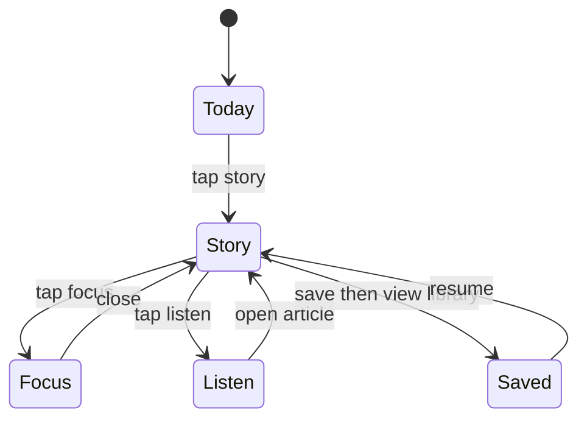

# Morrow v0.1 interaction spec

## Navigation model

Today, Listen, and Saved are top-level destinations. Story and Focus reading are contextual destinations that preserve their entry point.

## Today

- Tapping a topic filters the briefing in place and keeps the lead story visible.
- Tapping a story opens Story and preserves the current edition position.
- Pull to refresh checks for a new edition. Existing content remains visible while loading.

## Story

- Save changes state immediately and confirms with a short inline status.
- Listen opens Now Playing at the matching story position.
- Focus opens a reduced reader and inherits text size and theme.
- Back returns to the exact entry surface.

## Focus reading

- A single tap reveals or hides the reading toolbar.
- Text size changes reflow content without losing paragraph position.
- The progress indicator updates by section, not by raw pixel scroll.

## Now Playing

- Play and pause never change layout dimensions.
- Scrubbing updates elapsed time continuously and commits on release.
- Closing the full player keeps playback active.
- Returning to Story restores reading position and shows a persistent mini player.
- The mini player is available across Today, Story, and Saved.

## Saved

- Unfinished items appear before unread items.
- Removing an item is reversible during the current session.
- Empty state keeps a direct route back to Today.

## Accessibility baseline

- All controls have text alternatives and a minimum 44 by 44 point target.
- Reading text supports dynamic type without horizontal scrolling.
- Progress and selected states are communicated by more than color alone.
- Reduce Motion removes spatial transitions while preserving state feedback.
