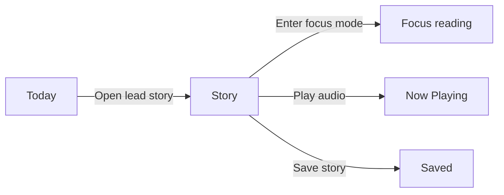
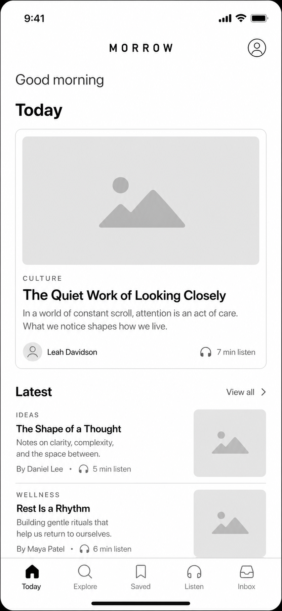
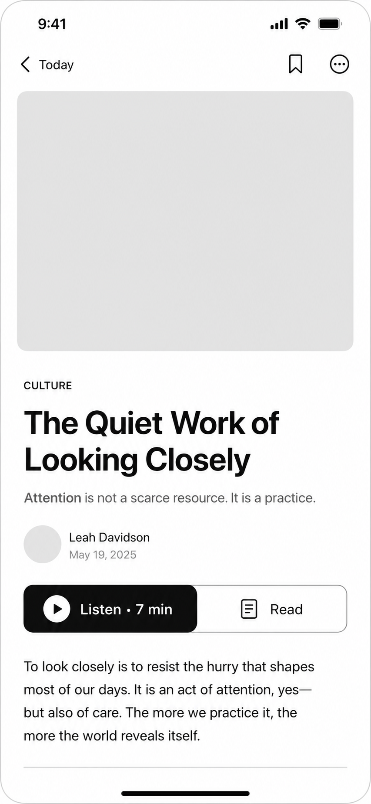
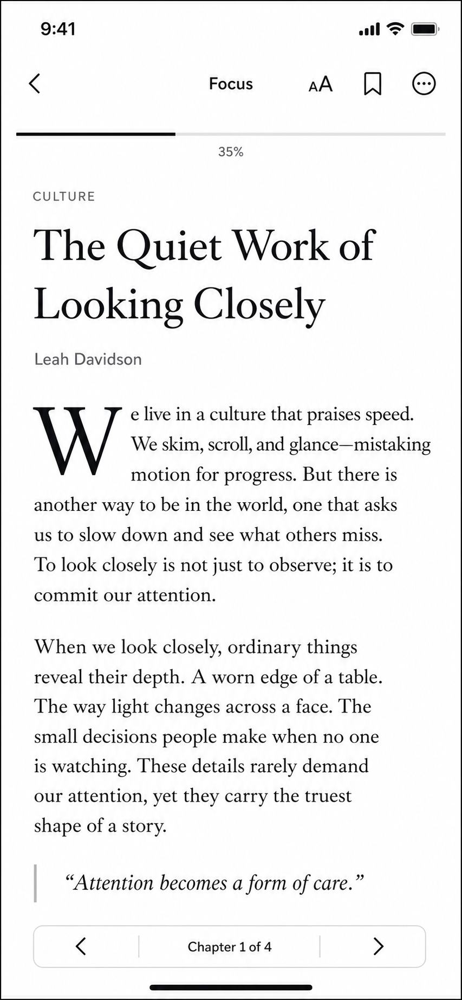
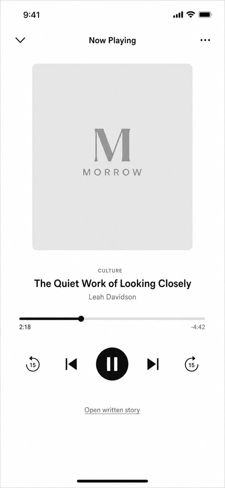
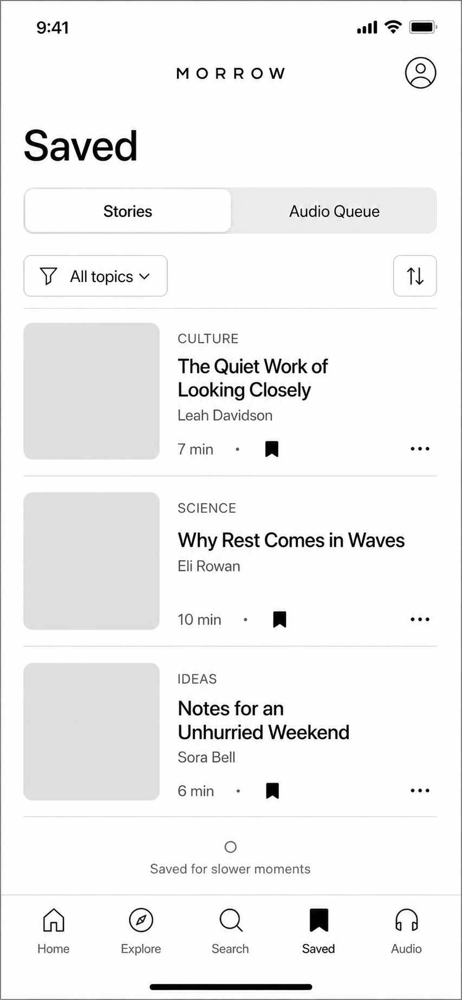

# Morrow v0.1 product brief

## Product idea

Morrow is a calm daily magazine for people who want depth without an endless feed. Each edition gives readers a deliberate starting point, then supports three useful outcomes: read with focus, listen while moving, or save for later.

## Audience

- Curious readers who value edited context over volume
- Commuters who move between reading and listening
- Subscribers who return to a small personal library

## Release goal

Validate one connected editorial journey before expanding the product:

## Product principles

1. One clear editorial choice beats an infinite list.
2. Reading controls stay quiet until they are needed.
3. Audio and text are two modes of the same story.
4. Saving is a promise to help the reader return, not a storage bin.

## Core screens

### Today

The daily entry point. A lead story anchors the edition, followed by a short, intentionally ordered briefing.

### Story

The shared hub for reading, listening, focus mode, and saving. The first viewport gives the title, editorial context, and a predictable action row.

### Focus reading

A reduced reading surface with progress, typography controls, and a single exit path back to the story.

### Now Playing

An audio-first surface with clear progress, primary playback controls, and a link to the written story.

### Saved

A compact personal library organized around unfinished and recently saved stories.

## In scope

| Capability | v0.1 behavior |
| --- | --- |
| Daily edition | One lead story and a short ordered briefing |
| Story reading | Standard article page and focus mode |
| Audio | One story player with primary playback controls |
| Saved library | Save, remove, filter, and resume |
| Continuity | Reading and listening progress persist locally |

## Not in scope

- Open-ended social feeds or comments
- Publisher tooling and editorial CMS workflows
- Recommendations based on behavioral profiling
- Full subscription checkout
- Offline audio downloads across multiple devices

## Success signals

- Readers open at least one story from Today.
- Readers reach 50 percent of a story in reading or listening mode.
- Saved stories are resumed within seven days.
- Readers can explain the difference between standard and focus reading without instruction.
